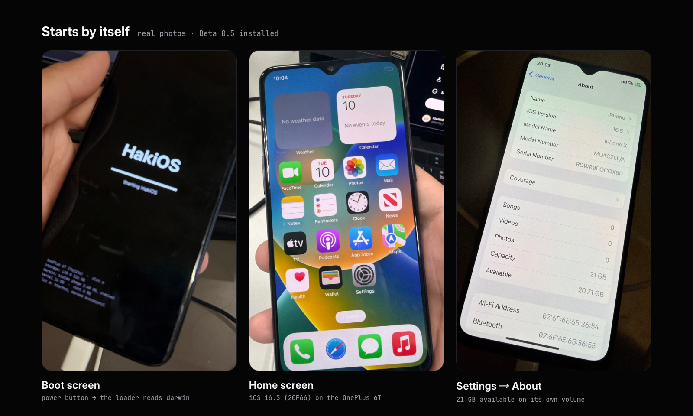

<div align="center">

# HakiOS for the OnePlus 6T

**iOS 16.5 on a OnePlus 6T** — the open-source Darwin (XNU) kernel and Apple's own user space,<br>
booting on a Snapdragon 845 with its GPU, Wi‑Fi, LTE, sound and touch working.

[](https://github.com/kiwiiiii-eth/hakios-fajita/releases/latest)
-555)
-555)
[](LICENSE)
[](https://github.com/kiwiiiii-eth/hakios-fajita/stargazers)
[](https://github.com/kiwiiiii-eth/hakios-fajita/releases)

[繁體中文](README.zh-TW.md) · [Release notes](releases/v0.8-beta.md) · [Changelog](CHANGELOG.md) · [Install guide](beta/README.md) · [Docs](#documentation)


</div>

## What it is

A device port of [HakiOS](https://github.com/oosexgang/hakios-xnu-kernel), which runs the XNU kernel on Qualcomm phones,
to the **OnePlus 6T**. The 6T's chip is a different generation from upstream's phone, so its GPU, modem, Wi‑Fi, touch,
battery, audio and Bluetooth drivers were written or ported for it.

Install it and the phone **starts iOS from its power button**, with no computer, and keeps your data on the phone.
Android stays installed in its other slot, one command away. Or boot it from a Mac without flashing anything at all.

> [!NOTE]
> **Not affiliated with Apple, OnePlus or Qualcomm.** No Apple software and no vendor firmware are in this repository:
> you download the iOS IPSW from Apple yourself and copy the firmware from your own phone. Apple's services (activation,
> Apple ID, App Store) are not supported and are not a goal.

## What you can do with it

- 📱 **Use iOS 16.5** on the 6T: lock screen, home screen, Settings, Safari, Notes, Voice Memos and the other built-in apps.
- 🔌 **Turn it on like a phone**: the power button shows a boot screen for about 20 seconds, then iOS. No Mac, no cable.
- 🌐 **Get online** over Wi‑Fi (5 GHz at about 100 Mbps; known networks are joined again by themselves) or **LTE** with a SIM.
- 🔊 **Hear and record**: the speaker plays system sounds and YouTube; Voice Memos records from the microphone.
- ⌨️ **Type on a Bluetooth keyboard** (BLE).
- 💾 **Keep your data**: settings, Wi‑Fi networks and app data live on a 20 GB volume on the phone.
- 🔁 **Go back to Android** at any time (`./switch.sh android`), or take HakiOS off completely (`./uninstall.sh`).
- 🛠 **Develop on real hardware**: SSH into the phone, read its system log and the threads of any process.

## On the phone

Real photos of Beta 0.5, installed on a OnePlus 6T.




## Status

As seen on the phone in November 2026 (Beta 0.8). ✅ works · 🟡 partly · ❌ not yet.
The drivers behind each line, and how the 6T compares with upstream's phone: [Hardware support](docs/hardware.md).

| | Feature | Status | Notes |
|---|---|:---:|---|
| **System** | Boot to the home screen | ✅ | SpringBoard and the built-in apps |
| | Start from the power button | ✅ | Installed with `./install.sh`; Android kept in its own slot |
| | Shut down, restart | ✅ | A restart from iOS takes under a minute |
| | Storage | ✅ | A 20 GB volume; Settings and iPhone Storage show it |
| | Clock and time zone | ✅ | Kept while the phone is off; the time zone from the cellular network |
| **Display & input** | Touch, buttons | ✅ | Read 120 times a second |
| | GPU | ✅ | Adreno 630, OpenGL ES 3.2 (Mesa), up to 60 fps |
| | Brightness | ✅ | Settings and Control Center |
| | Smooth scrolling | 🟡 | 55–60 fps, about one frame in 25 late; the display controller scales and flips |
| **Connectivity** | Wi‑Fi | ✅ | WPA2; 5 GHz at about 100 Mbps; known networks rejoined |
| | Cellular data | ✅ | iOS's own: Settings → Cellular, IPv4 and IPv6. Tested on FarEasTone (Taiwan) only |
| | Personal Hotspot | ❌ | In Settings; devices join but get no internet yet |
| | Phone calls, SMS | ❌ | Data only for now |
| | Bluetooth | ✅ | Pairs and remembers; BLE keyboards type; AirPods Pro 2 connect from their card and play |
| | Location (GPS) | 🟡 | Experimental (`gnss=1`): satellites tracked, Safari gets a position |
| | USB to a computer | ❌ | Only the boot loader's fastboot |
| **Audio** | Speaker | ✅ | Capped at −20 dBFS to protect it |
| | Microphone | ✅ | Voice Memos records |
| **Power & hardware** | Battery level, charging | ✅ | Charges at 1 A from USB |
| | Vibration, flashlight | ✅ | |
| | Temperature guard | ✅ | 21 sensors; the CPU and GPU slow down when hot |
| | Cameras | 🟡 | Main (autofocus, stabiliser) and front, about 30 fps; the second rear camera not yet |
| | Fingerprint, motion and light sensors | ❌ | Not started |
| **Apple services** | App Store, Apple ID, iCloud, Apple Maps | ❌ | Need an activated device; not a goal |

## Get started

You need a **OnePlus 6T** (fajita) with an **unlocked bootloader**, a **Mac** with [Homebrew](https://brew.sh), Apple's
**iOS 16.5 IPSW for iPhone X** (build 20F66, which you download yourself) and about 15 GB of free disk.
Download `hakios-6t-v0.8-beta.tar.gz` from the [latest release](https://github.com/kiwiiiii-eth/hakios-fajita/releases/latest), then:

```sh
brew install python sevenzip zstd coreutils android-platform-tools
tar xzf hakios-6t-v0.8-beta.tar.gz && cd hakios-6t-v0.8-beta
./setup.sh ~/Downloads/iPhone10,3,iPhone10,6_16.5_20F66_Restore.ipsw   # once: your phone's firmware, your IPSW
./run.sh        # try it from the Mac: nothing is flashed, a reboot is Android again
./install.sh    # or install it: the phone then starts iOS by itself
```

> [!WARNING]
> **`./install.sh` erases Android's data** (apps, photos, accounts) to make room for iOS. It backs up everything it
> changes first and asks you to type `ERASE`; `./uninstall.sh` puts the phone back. Android itself stays installed.

The [install guide](beta/README.md) explains every step and what to try once the lock screen is up.

## How it works

<picture>
  <source media="(prefers-color-scheme: dark)" srcset="docs/images/boot-flow-dark.png">
  
</picture>

The phone's own bootloader starts **U-Boot**, which starts the **HakiOS loader**. The loader reads the iOS system image
(from the phone's flash when installed, over USB from a Mac otherwise), describes the hardware to the kernel and starts
**XNU** with the 6T's drivers. From there on it is iOS's own `launchd`, daemons and SpringBoard.

<picture>
  <source media="(prefers-color-scheme: dark)" srcset="docs/images/storage-dark.png">
  
</picture>

Installing shortens Android's `userdata` and adds one partition, `darwin`, at its end: the read-only iOS system image
and the data volume iOS writes to. Nothing else on the phone changes. More in [How it boots](docs/how-it-boots.md).

## Documentation

| | |
|---|---|
| [How it boots](docs/how-it-boots.md) | The two ways to boot, the storage layout, and exactly what is written to the phone |
| [Hardware support](docs/hardware.md) | Every part of the phone, its driver, and how the 6T compares with upstream's phone |
| [The hard parts](docs/hard-parts.md) | The bugs that took longest, written down for the next Snapdragon 845 port |
| [Building from source](docs/building.md) | The repositories, the build, the firmware and U-Boot |
| [Install guide](beta/README.md) | The test kit: setup, run, install, update, uninstall, what to try |
| [Changelog](CHANGELOG.md) | What changed in each release |

## Contact and support

- Issues and reports: [GitHub issues](https://github.com/kiwiiiii-eth/hakios-fajita/issues), with the log (the install
  guide says where it is), what you did and what you saw.
- X: [@0x718_718](https://x.com/0x718_718)
- Donations (BTC): `bc1p6n329lsup5kpyemsvhqen70h0a4nc2ujyxflza5tfw6a4j8r4afq47gf58`

## Star history

<a href="https://star-history.com/#kiwiiiii-eth/hakios-fajita&Date">
  <picture>
    <source media="(prefers-color-scheme: dark)" srcset="https://api.star-history.com/svg?repos=kiwiiiii-eth/hakios-fajita&type=Date&theme=dark">
    <source media="(prefers-color-scheme: light)" srcset="https://api.star-history.com/svg?repos=kiwiiiii-eth/hakios-fajita&type=Date">
    
  </picture>
</a>

## Credits

- **[HakiOS](https://github.com/oosexgang/hakios-xnu-kernel)** (oosexgang and contributors): the XNU port, the loader,
  the user space and tooling this port stands on, and the drivers the 6T's were modelled on.
- **[ios-fajita](https://github.com/edi194/ios-fajita)** by edi194, built on [ios-sweet](https://github.com/dipa-studio/ios-sweet):
  the first iOS on this phone (software rendering, October 2026), its boot image parameters and the touch controller's
  init sequence. This port started as [a fork of it](https://github.com/kiwiiiii-eth/ios-fajita).
- **[postmarketOS](https://postmarketos.org) and mainline Linux** for SDM845: the reference for every rewritten driver;
  ath10k (ISC) is compiled unchanged on LinuxKPI.
- [LineageOS](https://github.com/LineageOS/android_kernel_oneplus_sdm845), [Mesa](https://mesa3d.org) freedreno,
  [U-Boot](https://u-boot.org), [bkerler/edl](https://github.com/bkerler/edl); the boot screen is lettered in
  [Inter](https://rsms.me/inter/) and [JetBrains Mono](https://www.jetbrains.com/lp/mono/).

## License

This repository's own files (configs, scripts, docs, `hostbin/`) are MIT ([LICENSE](LICENSE)). `u-boot/`,
`prebuilt/u-boot.bin` and `prebuilt/u-boot-install.bin` are GPL-2.0+ (U-Boot), the device tree source GPL-2.0,
`prebuilt/mkbootimg.py` Apache-2.0 (AOSP). The kernel and drivers live in
[`hakios-xnu-kernel`](https://github.com/kiwiiiii-eth/hakios-xnu-kernel/tree/fajita) under its terms (XNU-derived code
APSL 2.0, the rest MIT); the boot screen's lettering is drawn from Inter and JetBrains Mono (SIL Open Font License 1.1).
