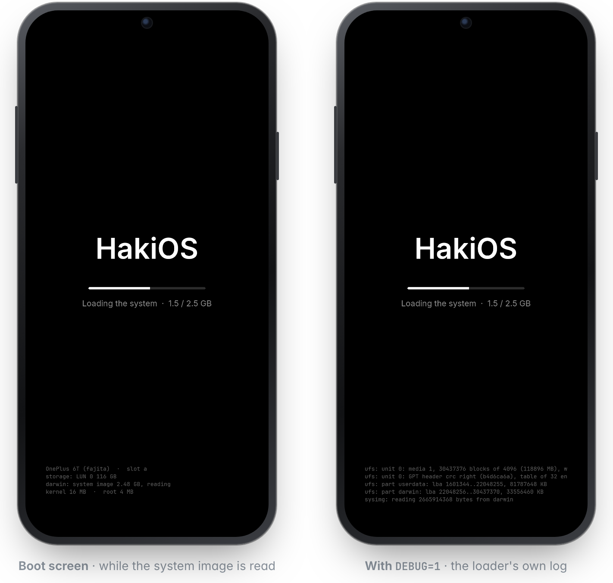
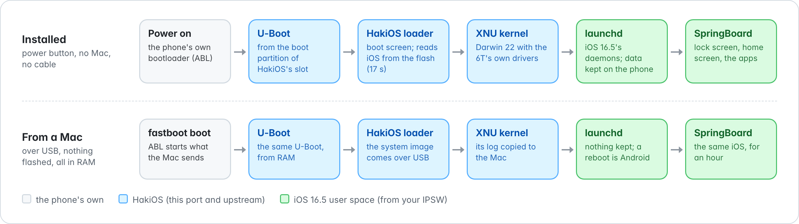
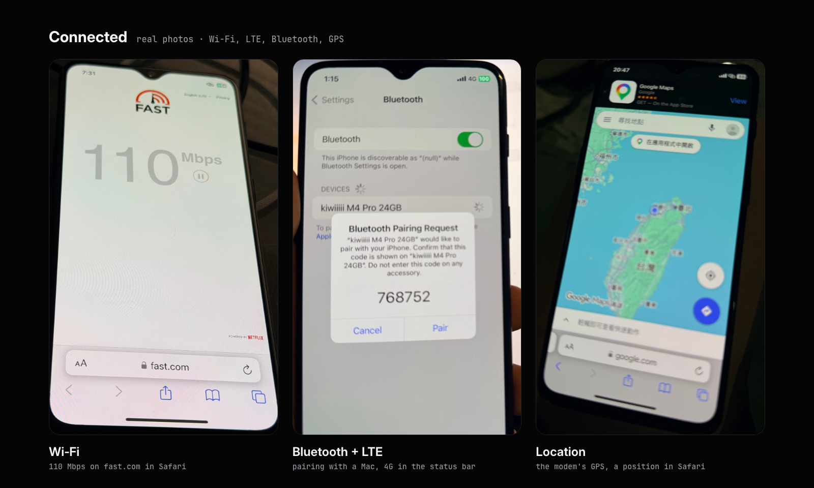

<div align="center">

# HakiOS for the OnePlus 6T

**iOS 16.5 on a OnePlus 6T**: the open-source Darwin (XNU) kernel and Apple's own user space on a Snapdragon 845.

[](https://github.com/kiwiiiii-eth/hakios-fajita/releases/latest)
-555)
-555)
[](LICENSE)
[](https://github.com/kiwiiiii-eth/hakios-fajita/stargazers)
[](https://github.com/kiwiiiii-eth/hakios-fajita/releases)

[繁體中文](README.zh-TW.md) · [Install guide](beta/README.md) · [Release notes](releases/v0.8.1-beta.md) · [Changelog](CHANGELOG.md) · [Docs](#documentation)



</div>

## What it is

A port of [HakiOS](https://github.com/oosexgang/hakios-xnu-kernel) (XNU on Qualcomm phones) to the **OnePlus 6T**, with
its GPU, modem, Wi‑Fi, touch, battery, audio, camera and Bluetooth drivers written or ported for it. Installed, the phone
**starts iOS from its power button** and keeps your data; Android stays in its other slot. Or boot it from a Mac without
flashing anything.

> [!NOTE]
> **Not affiliated with Apple, OnePlus or Qualcomm.** No Apple software and no vendor firmware are in this repository:
> you download the iOS IPSW from Apple and copy the firmware from your own phone. Apple's services (activation, Apple ID,
> App Store) are not supported and are not a goal.

## Highlights

| | |
|---|---|
| 📱 **iOS 16.5** | Lock screen, home screen, Settings, Safari, Camera, Notes, Voice Memos and the other built-in apps |
| 🔌 **Starts like a phone** | The power button, a 20-second boot screen, then iOS; shut down and restart from iOS |
| 🌐 **Online** | Wi‑Fi (5 GHz, about 100 Mbps) and cellular data through iOS's own Settings → Cellular |
| 📡 **Personal Hotspot** | From Settings or Control Center, as on an iPhone |
| 🎧 **Sound and Bluetooth** | Speaker, microphone, AirPods Pro 2, BLE keyboards |
| 📷 **Cameras** | Main (autofocus, stabiliser) and front |
| 💾 **Your data stays** | A 20 GB volume on the phone; back to Android with `./switch.sh android` |

## Status

As seen on the phone in November 2026 (Beta 0.8.1). ✅ works · 🟡 partly · ❌ not yet.
Every driver behind these, and how the 6T compares with upstream's phone: [Hardware support](docs/hardware.md).

| | Feature | | Notes |
|---|---|:---:|---|
| **System** | Boot, home screen, built-in apps | ✅ | From the power button once installed; Android kept in its own slot |
| | Shut down, restart, storage | ✅ | A restart takes under a minute; a 20 GB data volume |
| | Clock and time zone | ✅ | Kept while off; the time zone from the cellular network |
| **Display** | Touch, buttons, brightness | ✅ | Touch read 120 times a second |
| | GPU | ✅ | Adreno 630, OpenGL ES 3.2 (Mesa), up to 60 fps |
| | Smooth scrolling | 🟡 | 55–60 fps, about one frame in 25 late |
| **Connectivity** | Wi‑Fi | ✅ | WPA2, 2.4 and 5 GHz; known networks joined again |
| | Cellular data | ✅ | iOS's own, IPv4 and IPv6. Tested on FarEasTone (Taiwan) only |
| | Personal Hotspot | ✅ | 2.4 or 5 GHz (Maximize Compatibility); up to 54 Mbps (802.11g/a) |
| | Bluetooth | ✅ | Pairings kept; AirPods Pro 2 and BLE keyboards |
| | Location (GPS) | 🟡 | Experimental (`gnss=1`): satellites tracked, Safari gets a position |
| | Calls, SMS, USB to a computer | ❌ | Data only; USB only for the boot loader |
| **Audio** | Speaker, microphone | ✅ | The speaker capped at −20 dBFS to protect it |
| **Hardware** | Battery, charging | ✅ | Charges at 1 A from USB |
| | Vibration, flashlight, temperature guard | ✅ | 21 sensors; CPU and GPU slow down when hot |
| | Cameras | 🟡 | Main and front, about 30 fps; the second rear camera not yet |
| | Fingerprint, motion and light sensors | ❌ | Not started |
| **Apple services** | App Store, Apple ID, iCloud, Apple Maps | ❌ | Need an activated device; not a goal |

## Get started

You need a **OnePlus 6T** (fajita) with an **unlocked bootloader**, a **Mac** with [Homebrew](https://brew.sh), Apple's
**iOS 16.5 IPSW for iPhone X** (build 20F66, downloaded by you) and about 15 GB of free disk. Get
`hakios-6t-v0.8.1-beta.tar.gz` from the [latest release](https://github.com/kiwiiiii-eth/hakios-fajita/releases/latest):

```sh
brew install python sevenzip zstd coreutils android-platform-tools
tar xzf hakios-6t-v0.8.1-beta.tar.gz && cd hakios-6t-v0.8.1-beta
./setup.sh ~/Downloads/iPhone10,3,iPhone10,6_16.5_20F66_Restore.ipsw   # once
./run.sh        # try it from the Mac: nothing is flashed
./install.sh    # or install it: the phone then starts iOS by itself
```

> [!WARNING]
> **The first `./install.sh` erases Android's data** (apps, photos, accounts) to make room for iOS. It backs up what it
> changes and asks you to type `ERASE` first; `./uninstall.sh` puts the phone back. Android itself stays installed.

Every step, and what to try once the lock screen is up: the [install guide](beta/README.md).

## How it works

<picture>
  <source media="(prefers-color-scheme: dark)" srcset="docs/images/boot-flow-dark.png">
  
</picture>

The phone's bootloader starts **U-Boot**, which starts the **HakiOS loader**. The loader reads the iOS system image (from
the phone's flash when installed, over USB from a Mac otherwise) and starts **XNU** with the 6T's drivers; from there it
is iOS's own `launchd`, daemons and SpringBoard. Installing adds one partition, `darwin`, at the end of Android's
`userdata`: the system image and iOS's data volume. More in [How it boots](docs/how-it-boots.md).

## Photos




## Documentation

| | |
|---|---|
| [Install guide](beta/README.md) | The test kit: setup, run, install, update, uninstall, what to try |
| [How it boots](docs/how-it-boots.md) | The two ways to boot, the storage layout, what is written to the phone |
| [Hardware support](docs/hardware.md) | Every part of the phone, its driver, and upstream's phone beside it |
| [The hard parts](docs/hard-parts.md) | The bugs that took longest, for the next Snapdragon 845 port |
| [Building from source](docs/building.md) | The repositories, the build, the firmware and U-Boot |
| [Changelog](CHANGELOG.md) | What changed in each release |

## Support

[GitHub issues](https://github.com/kiwiiiii-eth/hakios-fajita/issues) (with the log, what you did and what you saw) ·
X [@0x718_718](https://x.com/0x718_718) · BTC `bc1p6n329lsup5kpyemsvhqen70h0a4nc2ujyxflza5tfw6a4j8r4afq47gf58`

## Credits

- **[HakiOS](https://github.com/oosexgang/hakios-xnu-kernel)** (oosexgang and contributors): the XNU port, the loader, the
  user space and tooling this port stands on, and the drivers the 6T's were modelled on.
- **[ios-fajita](https://github.com/edi194/ios-fajita)** by edi194, built on [ios-sweet](https://github.com/dipa-studio/ios-sweet):
  the first iOS on this phone (October 2026), its boot image parameters and the touch controller's init sequence. This
  port started as [a fork of it](https://github.com/kiwiiiii-eth/ios-fajita).
- **[postmarketOS](https://postmarketos.org) and mainline Linux** for SDM845: the reference for every rewritten driver;
  ath10k (ISC) is compiled unchanged on LinuxKPI.
- [LineageOS](https://github.com/LineageOS/android_kernel_oneplus_sdm845), [Mesa](https://mesa3d.org) freedreno,
  [U-Boot](https://u-boot.org), [bkerler/edl](https://github.com/bkerler/edl); the boot screen is lettered in
  [Inter](https://rsms.me/inter/) and [JetBrains Mono](https://www.jetbrains.com/lp/mono/).

## Star history

<a href="https://star-history.com/#kiwiiiii-eth/hakios-fajita&Date">
  <picture>
    <source media="(prefers-color-scheme: dark)" srcset="https://api.star-history.com/svg?repos=kiwiiiii-eth/hakios-fajita&type=Date&theme=dark">
    <source media="(prefers-color-scheme: light)" srcset="https://api.star-history.com/svg?repos=kiwiiiii-eth/hakios-fajita&type=Date">
    
  </picture>
</a>

<details>
<summary><b>License</b></summary>

This repository's own files (configs, scripts, docs, `hostbin/`) are MIT ([LICENSE](LICENSE)). `u-boot/`,
`prebuilt/u-boot.bin` and `prebuilt/u-boot-install.bin` are GPL-2.0+ (U-Boot), the device tree source GPL-2.0,
`prebuilt/mkbootimg.py` Apache-2.0 (AOSP). The kernel and drivers live in
[`hakios-xnu-kernel`](https://github.com/kiwiiiii-eth/hakios-xnu-kernel/tree/fajita) under its terms (XNU-derived code
APSL 2.0, the rest MIT); the boot screen's lettering is drawn from Inter and JetBrains Mono (SIL Open Font License 1.1).

</details>
