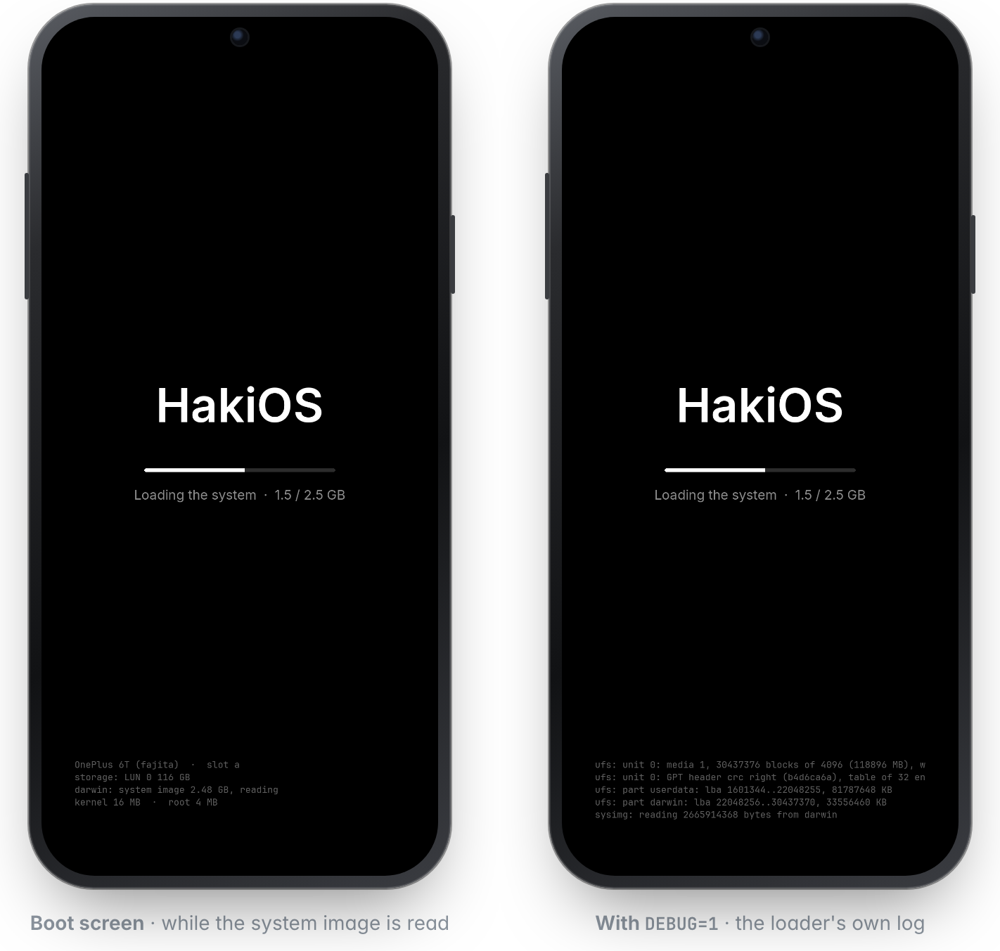
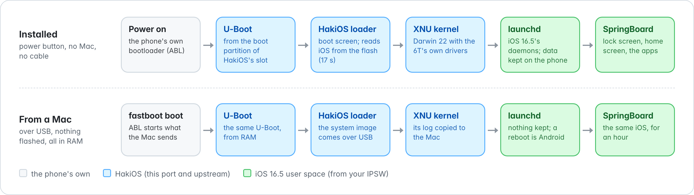
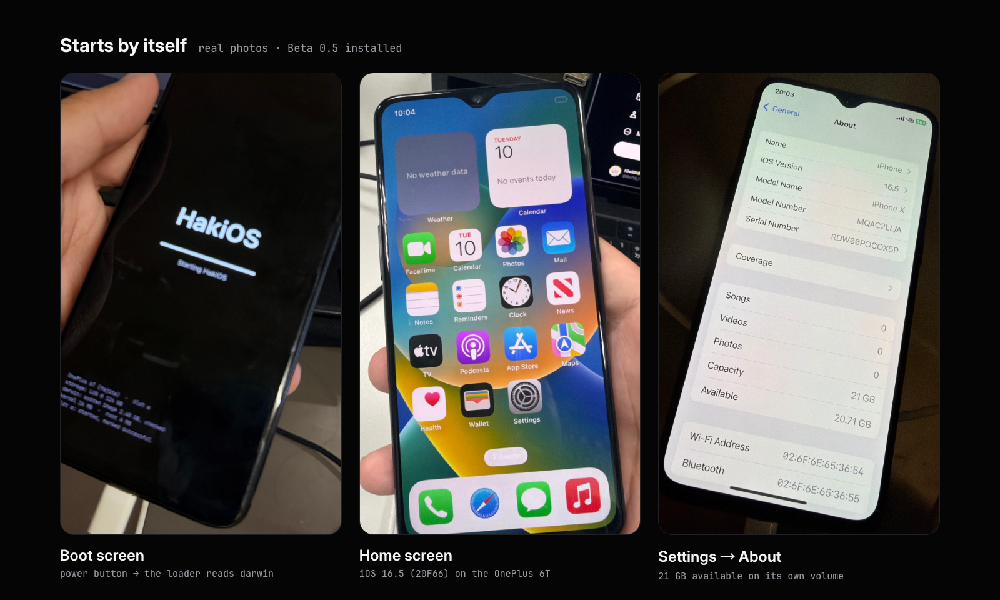
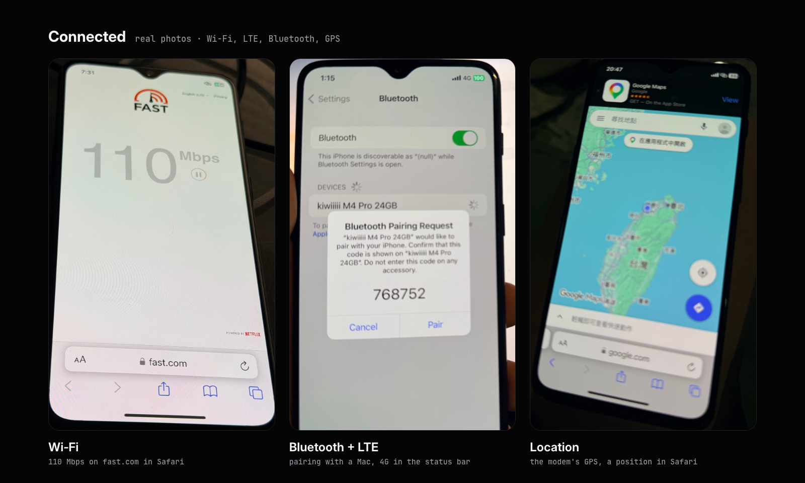

<div align="center">

# OPiOS 16.5 (HakiOS) – OnePlus 6T

**讓 OnePlus 6T 跑 iOS 16.5**：開源的 Darwin（XNU）核心，加上 Apple 原本的使用者空間，跑在 Snapdragon 845 上。

[](https://github.com/kiwiiiii-eth/hakios-fajita/releases/latest)
-555)
-555)
[](LICENSE)
[](https://github.com/kiwiiiii-eth/hakios-fajita/stargazers)
[](https://github.com/kiwiiiii-eth/hakios-fajita/releases)

[English](README.md) · [安裝說明](beta/README.md#繁體中文) · [版本說明](releases/v0.8.1-beta.md#繁體中文) · [更新紀錄](CHANGELOG.zh-TW.md) · [文件](#文件)

🧪 **iOS 26 除錯版（開發中）**：[現況](docs/ios26.zh-TW.md) · [原始碼（`ios26` 分支）](https://github.com/kiwiiiii-eth/hakios-xnu-kernel/tree/ios26)



</div>

## 這是什麼

**OPiOS**（OP 是 OnePlus 的縮寫）是 [HakiOS](https://github.com/oosexgang/hakios-xnu-kernel)（把 XNU 核心搬到高通手機上）的 **OnePlus 6T** 移植。GPU、數據機、Wi‑Fi、觸控、
電池、音訊、相機、藍牙的驅動，都是為 6T 另外寫或移植的。安裝後**按電源鍵就直接開進 iOS**，資料存在手機上；Android 留在另一個
slot。也可以從 Mac 開機，什麼都不刷。

> [!NOTE]
> **與 Apple、OnePlus、高通無關。** 這個 repo 不含任何 Apple 軟體或原廠韌體：iOS 的 IPSW 要自己向 Apple 下載，韌體從自己的手機複製。
> Apple 服務（啟用、Apple ID、App Store）不支援，也不打算支援。

## 重點功能

| | |
|---|---|
| 📱 **iOS 16.5** | 鎖定畫面、主畫面、設定、Safari、相機、備忘錄、語音備忘錄等內建 App |
| 🔌 **像一般手機一樣開機** | 按電源鍵，約 20 秒開機畫面後進 iOS；iOS 裡能關機、重新開機 |
| 🌐 **上網** | Wi‑Fi（5 GHz 約 100 Mbps），以及由 iOS「設定 → 行動服務」管理的行動數據 |
| 📡 **個人熱點** | 從「設定」或控制中心打開，跟 iPhone 一樣 |
| 🎧 **聲音與藍牙** | 喇叭、麥克風、AirPods Pro 2、BLE 鍵盤 |
| 📷 **相機** | 主鏡頭（自動對焦、防手震）與前鏡頭 |
| 💾 **資料會保留** | 手機上 20 GB 的磁碟區；`./switch.sh android` 隨時切回 Android |

## 功能狀態

2026 年 11 月在實機上確認的結果（Beta 0.8.1）。✅ 可用・🟡 部分可用・❌ 還不能用。
每一項背後的驅動，以及跟上游參考機的比較：[硬體支援](docs/hardware.zh-TW.md)。

| | 功能 | | 說明 |
|---|---|:---:|---|
| **系統** | 開機、主畫面、內建 App | ✅ | 安裝後按電源鍵開機；Android 留在自己的 slot |
| | 關機、重新開機、儲存空間 | ✅ | 重新開機不到 1 分鐘；20 GB 資料磁碟區 |
| | 時間與時區 | ✅ | 關機時也持續計時；時區跟著行動網路 |
| **螢幕** | 觸控、按鍵、亮度 | ✅ | 觸控每秒讀 120 次 |
| | GPU | ✅ | Adreno 630、OpenGL ES 3.2（Mesa），最高 60 fps |
| | 滑動順暢度 | 🟡 | 每秒 55～60 幀，約 25 幀有 1 幀晚到 |
| **連線** | Wi‑Fi | ✅ | WPA2、2.4 與 5 GHz；自動連回已知網路 |
| | 行動數據 | ✅ | 由 iOS 自己管理，IPv4 與 IPv6。只在遠傳（台灣）實測過 |
| | 個人熱點 | ✅ | 2.4 或 5 GHz（最大化相容性）；最快 54 Mbps（802.11g/a） |
| | 藍牙 | ✅ | 配對會保留；AirPods Pro 2、BLE 鍵盤 |
| | 定位（GPS） | 🟡 | 實驗中（`gnss=1`）：能追到衛星，Safari 拿得到位置 |
| | 打電話、簡訊、USB 連電腦 | ❌ | 目前只有數據；USB 只給開機時的 loader 用 |
| **音訊** | 喇叭、麥克風 | ✅ | 為保護喇叭，限制在 −20 dBFS |
| **硬體** | 電量、充電 | ✅ | USB 1 A 充電 |
| | 震動、手電筒、溫度保護 | ✅ | 21 個感測器；過熱時 CPU、GPU 降頻 |
| | 相機 | 🟡 | 主鏡頭與前鏡頭，約每秒 30 幀；第二顆後鏡頭還沒 |
| | 指紋、動作與光線感測器 | ❌ | 還沒開始 |
| **Apple 服務** | App Store、Apple ID、iCloud、Apple 地圖 | ❌ | 需要已啟用的裝置；不打算支援 |

## 開始使用

需要：**已解鎖 bootloader 的 OnePlus 6T**（fajita）、裝好 [Homebrew](https://brew.sh) 的 **Mac**、自己下載的
**iPhone X iOS 16.5 IPSW**（20F66），以及約 15 GB 空間。從[最新版本](https://github.com/kiwiiiii-eth/hakios-fajita/releases/latest)下載
`hakios-6t-v0.8.1-beta.tar.gz`：

```sh
brew install python sevenzip zstd coreutils android-platform-tools
tar xzf hakios-6t-v0.8.1-beta.tar.gz && cd hakios-6t-v0.8.1-beta
./setup.sh ~/Downloads/iPhone10,3,iPhone10,6_16.5_20F66_Restore.ipsw   # 只跑一次
./run.sh        # 從 Mac 開機試用：不刷任何分區
./install.sh    # 或安裝到手機：之後按電源鍵直接進 iOS
```

> [!WARNING]
> **第一次 `./install.sh` 會清除 Android 的資料**（App、照片、帳號），騰出空間給 iOS。它會先備份會改動的東西，並要你輸入 `ERASE`；
> `./uninstall.sh` 可以還原。Android 系統本身會保留。

每一步在做什麼、進到鎖定畫面後可以試什麼：[安裝說明](beta/README.md#繁體中文)。

## 運作方式

<picture>
  <source media="(prefers-color-scheme: dark)" srcset="docs/images/boot-flow-dark.png">
  
</picture>

手機原本的 bootloader 先啟動 **U-Boot**，再啟動 **HakiOS loader**。loader 讀進 iOS 系統映像（安裝版從手機的 flash 讀，從 Mac 開機則經
USB 傳入），啟動帶有 6T 驅動的 **XNU**，之後就是 iOS 自己的 `launchd`、各項服務與 SpringBoard。安裝時會在 Android 的 `userdata`
尾端加一個 `darwin` 分區，放系統映像和 iOS 的資料磁碟區。詳見[開機流程](docs/how-it-boots.zh-TW.md)。

## 實機照片




## 文件

| | |
|---|---|
| [安裝說明](beta/README.md#繁體中文) | 測試包：setup、run、安裝、更新、移除、可以試什麼 |
| [開機流程](docs/how-it-boots.zh-TW.md) | 兩種開機方式、儲存配置、會寫入手機的東西 |
| [硬體支援](docs/hardware.zh-TW.md) | 手機每個部件、對應驅動，以及和上游參考機的比較 |
| [最難的幾關](docs/hard-parts.zh-TW.md) | 花最多時間的問題，記給下一個 Snapdragon 845 移植參考 |
| [從原始碼建置](docs/building.zh-TW.md) | 相關 repo、建置步驟、韌體與 U-Boot |
| [更新紀錄](CHANGELOG.zh-TW.md) | 每一版改了什麼 |

## 聯絡與支持

[GitHub issues](https://github.com/kiwiiiii-eth/hakios-fajita/issues)（請附上記錄、你做了什麼、看到什麼）・
X [@0x718_718](https://x.com/0x718_718)・捐款（BTC）`bc1p6n329lsup5kpyemsvhqen70h0a4nc2ujyxflza5tfw6a4j8r4afq47gf58`

## 致謝

- **[HakiOS](https://github.com/oosexgang/hakios-xnu-kernel)**（oosexgang 與貢獻者）：XNU 移植、loader、使用者空間與工具，以及 6T 驅動參考的驅動。
- **[ios-fajita](https://github.com/edi194/ios-fajita)**（edi194，基於 [ios-sweet](https://github.com/dipa-studio/ios-sweet)）：6T 上第一個跑起 iOS 的專案（2026 年 10 月），開機映像參數與觸控初始化序列來自它。本移植一開始是[它的 fork](https://github.com/kiwiiiii-eth/ios-fajita)。
- **[postmarketOS](https://postmarketos.org) 與主線 Linux** 的 SDM845 支援：每支重寫驅動的參考；ath10k（ISC）原封不動編在 LinuxKPI 上。
- [LineageOS](https://github.com/LineageOS/android_kernel_oneplus_sdm845)、[Mesa](https://mesa3d.org) freedreno、[U-Boot](https://u-boot.org)、[bkerler/edl](https://github.com/bkerler/edl)；開機畫面字型為 [Inter](https://rsms.me/inter/) 與 [JetBrains Mono](https://www.jetbrains.com/lp/mono/)。

## Star 走勢

<a href="https://star-history.com/#kiwiiiii-eth/hakios-fajita&Date">
  <picture>
    <source media="(prefers-color-scheme: dark)" srcset="https://api.star-history.com/svg?repos=kiwiiiii-eth/hakios-fajita&type=Date&theme=dark">
    <source media="(prefers-color-scheme: light)" srcset="https://api.star-history.com/svg?repos=kiwiiiii-eth/hakios-fajita&type=Date">
    
  </picture>
</a>

<details>
<summary><b>授權</b></summary>

本 repo 自己的檔案（設定、腳本、文件、`hostbin/`）採 MIT（[LICENSE](LICENSE)）。`u-boot/`、`prebuilt/u-boot.bin`、`prebuilt/u-boot-install.bin`
是 GPL-2.0+（U-Boot），裝置樹原始碼 GPL-2.0，`prebuilt/mkbootimg.py` 是 Apache-2.0（AOSP）。核心與驅動在
[`hakios-xnu-kernel`](https://github.com/kiwiiiii-eth/hakios-xnu-kernel/tree/fajita)，依其授權（XNU 衍生部分 APSL 2.0，其餘 MIT）；
開機畫面的字由 Inter 與 JetBrains Mono（SIL Open Font License 1.1）繪製。

</details>
