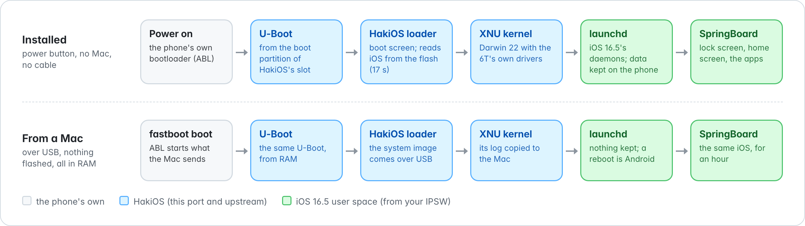
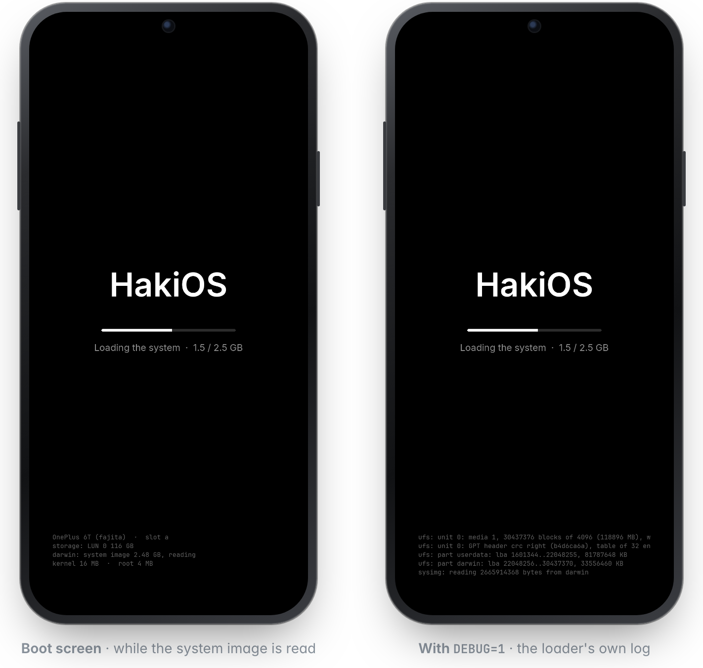
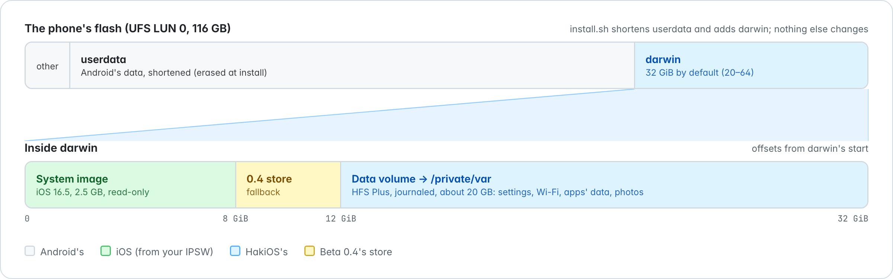

# How it boots

[← README](../README.md) · [How it boots](how-it-boots.md) · [Hardware support](hardware.md) · [The hard parts](hard-parts.md) · [Building from source](building.md) · [Changelog](../CHANGELOG.md) · [繁體中文](how-it-boots.zh-TW.md)

<picture>
  <source media="(prefers-color-scheme: dark)" srcset="images/boot-flow-dark.png">
  
</picture>

## Two ways to boot

### Installed: from the power button

`./install.sh` (Beta 0.4 and later). No Mac and no cable once it is installed.

1. **ABL**, the phone's own bootloader, starts the boot partition of the active slot. HakiOS is in the slot Android
   does not use, so `./switch.sh android` (a `set_active`) is all it takes to go back.
2. **U-Boot** (`prebuilt/u-boot-install.bin`) starts the HakiOS loader without writing anything on the screen.
3. The **HakiOS loader** draws the boot screen, reads the iOS system image from the partition `darwin` (2.5 GB, about
   17 seconds) and checks it, marks the slot as started (as Android does), and starts the kernel. If it cannot read
   the system image, it goes back to ABL's fastboot rather than leaving a black screen.
4. **XNU** starts with the 6T's drivers; iOS's `launchd` mounts the data volume on `/private/var` and starts the
   daemons and SpringBoard. The lock screen is up a few minutes after the power button.

The boot screen shows the progress of reading (85% of the bar) and checking the system image, and the boot's facts at
the bottom. An image built with `DEBUG=1 ./install.sh` shows the loader's own last lines there instead.

### From a Mac: nothing flashed

`./run.sh` (or `scripts/run-darwin-live.sh` from a source tree).

1. The Mac `fastboot boot`s U-Boot and the loader into RAM. U-Boot sets the phone's reboot reason (one PMIC register,
   `0x88f`) so that every reset lands in fastboot again.
2. The **loader** takes the 2.4 GB system image over USB (about a minute) and keeps it in RAM.
3. **XNU** starts; the Mac copies its log to `out/logs/` while it runs. A run lasts an hour by default
   (`fastboot oem stop` ends it early), then the phone goes back to fastboot. A reboot is Android again.

## Storage layout

<picture>
  <source media="(prefers-color-scheme: dark)" srcset="images/storage-dark.png">
  
</picture>

| In `darwin`, from its start | What |
|---|---|
| 0 – 8 GiB | The iOS system image (read-only; 2.5 GB of it used), with a header the loader checks |
| 8 – 12 GiB | Beta 0.4's store: `/private/var` packed into two slots. Left in place as a fallback; 0.5 moves the newest one into the data volume once |
| 12 GiB – end | The data volume: HFS Plus, journaled, case-sensitive, about 20 GB, mounted on `/private/var` |

`darwin` is 32 GiB by default; `GIB=` sets 20 to 64 (the data volume is whatever is past 12 GiB).

## What is written to the phone

**From a Mac** (`./run.sh`)

- One PMIC register, the reboot reason `0x88f`, so that a reset lands in fastboot.
- No partition.

**Installed** (`./install.sh`), with your consent and after a backup of everything it changes (`./uninstall.sh` puts it back)

- **LUN 0's partition table**: `userdata` shortened and `darwin` added at its end. **Android's data is erased.**
  Only those two entries may change; the loader checks the new table against both copies on the phone before it writes,
  and reads it back.
- **`darwin` itself**: the system image and the data volume.
- **The boot partition of HakiOS's slot**, with that slot's `dtbo` and `vbmeta` copied from Android's slot.
- **That slot's A/B attributes**: made active, and marked successful at every start.

**Either way, while the system runs**

- The charger's input and charge current limits, the flash LED and the haptic block: each limited to a list of allowed
  registers and read back after every write.
- With `ipa8=11` (LTE data), two of the modem's data settings (data on, the default data SIM) are changed in the
  modem's memory only, not in its partitions.

**Never touched**: `persist`, `modemst*`, `fsg`, `xbl`, `abl`, `tz`. The modem's file system is served read-only from
a copy in RAM.
