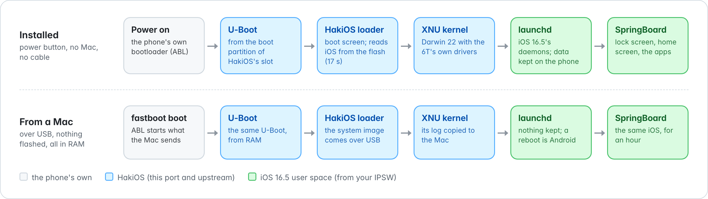
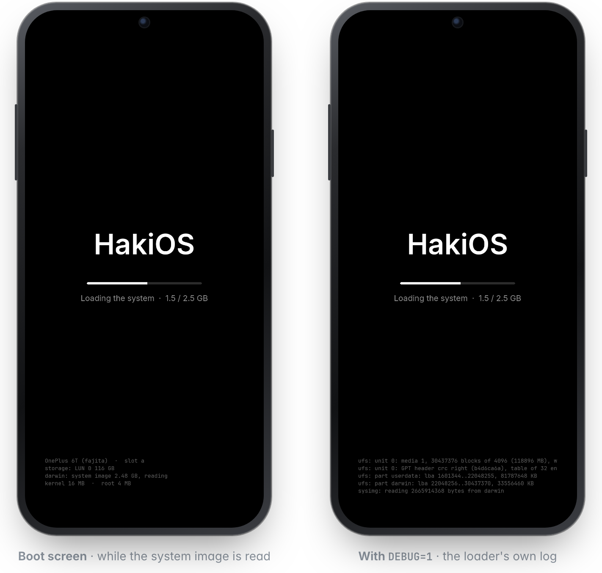
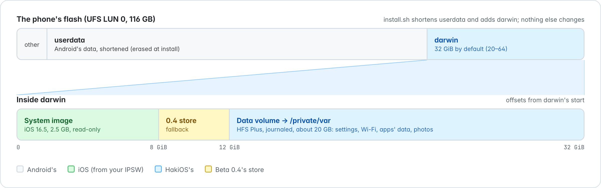

# 開機流程

[← README](../README.zh-TW.md) · [開機流程](how-it-boots.zh-TW.md) · [硬體支援](hardware.zh-TW.md) · [最難的幾關](hard-parts.zh-TW.md) · [從原始碼建置](building.zh-TW.md) · [更新紀錄](../CHANGELOG.zh-TW.md) · [English](how-it-boots.md)

<picture>
  <source media="(prefers-color-scheme: dark)" srcset="images/boot-flow-dark.png">
  
</picture>

## 兩種開機方式

### 安裝版：按電源鍵開機

`./install.sh`（Beta 0.4 起）。裝好後不需要 Mac，也不用接線。

1. **ABL**（手機原本的 bootloader）啟動目前使用中 slot 的開機分區。HakiOS 裝在 Android 沒在用的那個 slot，所以 `./switch.sh android`（一個 `set_active`）就能切回 Android。
2. **U-Boot**（`prebuilt/u-boot-install.bin`）直接啟動 HakiOS loader，不在螢幕上印任何字。
3. **HakiOS loader** 畫出開機畫面，從 `darwin` 分區讀進 iOS 系統映像（2.5 GB，約 17 秒）並檢查，把這個 slot 標記為開機成功（跟 Android 一樣），然後啟動核心。讀不到系統映像時，會退回 ABL 的 fastboot，不會停在黑畫面。
4. **XNU** 帶著 6T 的驅動啟動；iOS 的 `launchd` 把資料磁碟區掛到 `/private/var`，再啟動各項服務與 SpringBoard。按下電源鍵後幾分鐘內出現鎖定畫面。

開機畫面會顯示讀取（進度條的 85%）與檢查系統映像的進度，底部是開機資訊。用 `DEBUG=1 ./install.sh` 打包的映像，底部改顯示 loader 最後幾行原始記錄。

### 從 Mac 開機：什麼都不刷

`./run.sh`（原始碼樹裡是 `scripts/run-darwin-live.sh`）。

1. Mac 用 `fastboot boot` 把 U-Boot 和 loader 送進記憶體。U-Boot 在 PMIC 寫入重開原因（一個暫存器 `0x88f`），讓之後任何重開都停在 fastboot。
2. **loader** 經 USB 收下 2.4 GB 的系統映像（約 1 分鐘），放在記憶體裡。
3. **XNU** 啟動；執行期間 Mac 會即時把記錄存到 `out/logs/`。一輪預設 1 小時（`fastboot oem stop` 可提早結束），結束後手機回到 fastboot。重開機就回到 Android。

## 儲存配置

<picture>
  <source media="(prefers-color-scheme: dark)" srcset="images/storage-dark.png">
  
</picture>

| `darwin` 內的位置（從開頭算） | 內容 |
|---|---|
| 0～8 GiB | iOS 系統映像（唯讀，實際用 2.5 GB），開頭有 loader 會檢查的標頭 |
| 8～12 GiB | Beta 0.4 的存檔：`/private/var` 打包存在兩個存檔槽。保留當備援；0.5 會把最新的一份搬進資料磁碟區，只搬一次 |
| 12 GiB～結尾 | 資料磁碟區：HFS+，有日誌、區分大小寫，約 20 GB，掛在 `/private/var` |

`darwin` 預設 32 GiB，可用 `GIB=` 設 20～64（資料磁碟區是 12 GiB 之後的部分）。

## 會寫入手機的東西

**從 Mac 開機**（`./run.sh`）

- 一個 PMIC 暫存器：重開原因 `0x88f`，讓重開後停在 fastboot。
- 不寫任何分區。

**安裝**（`./install.sh`），經你確認，並先備份所有會改動的東西（`./uninstall.sh` 可還原）

- **LUN 0 的分區表**：縮短 `userdata`，在尾端加上 `darwin`。**會清除 Android 的資料。** 只准改這兩個 entry；loader 寫入前會對照手機上的兩份副本檢查，寫完再讀回。
- **`darwin` 本身**：系統映像與資料磁碟區。
- **HakiOS 那個 slot 的開機分區**，以及從 Android 那個 slot 複製過來的 `dtbo`、`vbmeta`。
- **該 slot 的 A/B 屬性**：設為使用中，每次開機標記成功。

**兩種方式下，系統執行時**

- 充電器的輸入與充電電流上限、閃光燈、震動模組：每一項都限定在暫存器白名單內，寫完都會讀回比對。
- 開 `ipa8=11`（LTE 上網）時，會改數據機的兩個數據設定（數據開關、預設數據 SIM），只改在數據機的記憶體裡，不寫回分區。

**完全不碰**：`persist`、`modemst*`、`fsg`、`xbl`、`abl`、`tz`。數據機要用的檔案系統，是從記憶體裡的副本以唯讀方式提供。
