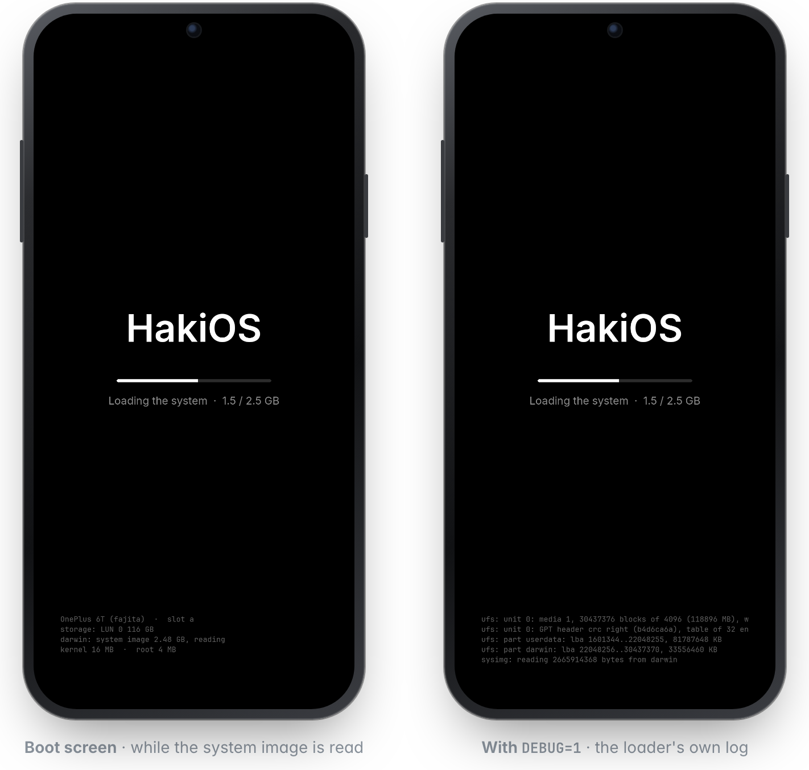

# Beta 0.5 — /private/var on its own 20 GB volume, and a boot screen

**HakiOS for the OnePlus 6T** runs the Darwin (XNU) kernel and the iOS 16.5 user space on a OnePlus 6T. Installed, the phone starts iOS from its power button; Android stays in its other slot. It is still a developer bring-up: you build it on your Mac from your own IPSW and your own phone's firmware. No Apple software and no vendor firmware are distributed here. [中文說明在下方](#繁體中文)

## Highlights

- 💾 **20 GB of storage on the phone.** `/private/var` is a real volume now: Settings shows 21 GB, and iPhone Storage counts it.
- ⚡ **Restarts in under a minute**, and a forced restart is safe: the volume is journaled.
- 🖥 **A boot screen** with a progress bar, instead of U-Boot's text.

## What's new

### Added
- **Data volume** for `/private/var`: HFS Plus, journaled, case-sensitive, about 20 GB, in the partition `darwin` from 12 GiB on. What iOS writes is on the flash at once.
- **Moving 0.4's data in**: the first start after installing or updating moves what Beta 0.4 kept into the volume, once. It counts only when the data comes back whole; otherwise that start runs as 0.4 did and the next one tries again. 0.4's slots are left as they were.
- **Boot screen** drawn by the loader: HakiOS, a progress bar while the system image is read (85%) and checked, a status line, and the boot's facts at the bottom (the phone and slot, the storage, the system image, the kernel). `DEBUG=1 ./install.sh` shows the loader's own log there instead.
- **Location, experimental** (`EXTRA="gnss=1"`): the modem's GPS sees satellites even indoors, Location Services are turned on by themselves, and Safari's geolocation gets a position.

### Changed
- **Restart** from iOS: under a minute (0.4 first spent a minute saving 380 MB).
- **U-Boot** no longer writes over the screen on an installed phone.
- **`install.sh`** makes the data volume (once, with macOS's own `newfs_hfs`; everything before 12 GiB is left alone and checked to be). `darwin` is 32 GiB by default; `GIB=` takes 20 to 64. A `darwin` that 0.4 made under 16 GiB gets no volume and keeps `/private/var` as 0.4 did.

### Fixed
- **Settings → General → About** showed about 1 GB of space; it shows 21 GB.
- **Settings → General → iPhone Storage** was empty; it counts the data volume (the read-only root now reports the volume's space, as an iPhone's root shares its container's).

## Known issues

- **Apple's services** need an activated device and are not supported: Apple Maps shows no map (Google Maps in Safari works), and neither the App Store nor Apple ID work.
- **Once**, a freshly flashed boot partition came back to fastboot before iOS; the next start was normal. If it happens, choose Start in the fastboot menu (volume keys, then power).
- **`installcoordinationd`** restarts every few seconds (a directory from an older store has the wrong owner). Nothing depends on it without an App Store.
- **Going back to 0.4** shows the data as it was when 0.5 moved it; what was written under 0.5 stays in the volume.
- **Bluetooth** pairings are forgotten at every boot; with `./run.sh` nothing on the phone is kept (install for that).
- Scrolling is not as smooth as an iPhone's; no cameras; no calls or SMS; `neofetch` says "iPhone X / A11".

## Install or update

| You have | Do |
|---|---|
| Nothing yet | Download the kit below, then `./setup.sh <your IPSW>` and `./install.sh` — see the [install guide](https://github.com/kiwiiiii-eth/hakios-fajita/blob/main/beta/README.md). **Erases Android's data.** |
| Beta 0.4 installed | `./setup.sh` with the new kit, then `./install.sh` again: nothing is erased, the volume is made, your data moves in at the next start |
| Just want to look | `./run.sh` boots it from the Mac; nothing is flashed |

When something breaks, open an [issue](https://github.com/kiwiiiii-eth/hakios-fajita/issues) with the log (`work/out/logs/` for runs, `~/HakiOS-6T-backup/<serial>/logs/` for installs), what you did and what you saw.

## Downloads

- **`hakios-6t-v0.5-beta.tar.gz`** (below): the test kit. The kernel, a loader without any device identity and our programs, prebuilt, plus the scripts. No Apple software, no firmware.
- Source: this repository at [`v0.5-beta`](https://github.com/kiwiiiii-eth/hakios-fajita/tree/v0.5-beta); the kernel at [`fajita-v0.5-beta`](https://github.com/kiwiiiii-eth/hakios-xnu-kernel/tree/fajita-v0.5-beta).
- Every release: [CHANGELOG](https://github.com/kiwiiiii-eth/hakios-fajita/blob/main/CHANGELOG.md).

Support: [issues](https://github.com/kiwiiiii-eth/hakios-fajita/issues) · X [@0x718_718](https://x.com/0x718_718) · BTC `bc1p6n329lsup5kpyemsvhqen70h0a4nc2ujyxflza5tfw6a4j8r4afq47gf58`

---

# 繁體中文

**HakiOS for OnePlus 6T** 讓 OnePlus 6T 跑 Darwin（XNU）核心＋iOS 16.5 使用者空間。安裝後按電源鍵直接進 iOS，Android 留在另一個 slot。目前仍是開發者移植：用你自己的 IPSW 和你自己手機的韌體在 Mac 上建置，這裡不散布任何 Apple 軟體或原廠韌體。

## 重點

- 💾 **手機上 20 GB 的儲存空間**：`/private/var` 現在是真正的磁碟區，「關於本機」顯示 21 GB，「iPhone 儲存空間」也正常統計。
- ⚡ **重新開機不到 1 分鐘**，強制重開也安全（磁碟區有日誌）。
- 🖥 **開機畫面**：有進度條，不再是 U-Boot 的文字。

## 更新內容

### 新增
- **資料磁碟區**：`/private/var` 改用 `darwin` 分區 12 GiB 之後的 HFS+（有日誌、區分大小寫），約 20 GB。iOS 寫的東西直接存在 flash。
- **搬入 0.4 的資料**：安裝或從 0.4 更新後的第一次開機，會把 0.4 存的資料搬進磁碟區，只搬一次。資料完整讀回才算數；否則那次開機照 0.4 的方式進行，下次再試。0.4 的存檔槽保持原樣。
- **開機畫面**（由 loader 繪製）：HakiOS 字樣、讀取（85%）與檢查系統映像的進度條、狀態列，以及底部的開機資訊（機型與 slot、儲存空間、系統映像、核心）。`DEBUG=1 ./install.sh` 會改顯示 loader 的原始記錄。
- **定位（實驗中，`EXTRA="gnss=1"`）**：室內就能看到衛星，定位服務自動打開，Safari 網頁定位拿得到位置。

### 改進
- **重新開機**：iOS 重開不到 1 分鐘（0.4 要先花約 1 分鐘存 380 MB）。
- **U-Boot**：安裝版不再把文字蓋在畫面上。
- **`install.sh`**：會建立資料磁碟區（只做一次，用 macOS 內建的 `newfs_hfs`；12 GiB 之前的內容不動並會檢查）。`darwin` 預設 32 GiB，`GIB=` 可設 20～64；0.4 時切得小於 16 GiB 的，不建立磁碟區，維持 0.4 的存法。

### 修正
- **設定 → 一般 → 關於本機**：原本只顯示約 1 GB，現在顯示 21 GB。
- **設定 → 一般 → iPhone 儲存空間**：原本是空的，現在會統計資料磁碟區（唯讀的根目錄改回報磁碟區的空間，跟真 iPhone 根目錄共用容器空間一樣）。

## 已知問題

- **Apple 服務**需要已啟用的裝置，不支援：Apple 地圖不顯示圖資（Safari 的 Google 地圖可用），App Store、Apple ID 也不能用。
- **曾有一次**剛刷好的開機分區沒進 iOS、退回 fastboot，再開一次就正常。遇到時在 fastboot 選單選 Start（音量鍵選、電源鍵確認）。
- **`installcoordinationd`** 每隔幾秒重啟（舊存檔帶來的一個目錄擁有者不對）；沒有 App Store，不影響使用。
- **退回 0.4** 會看到搬進磁碟區當時的資料；0.5 寫的資料留在磁碟區裡。
- **藍牙**配對每次開機都要重來；用 `./run.sh` 時資料不會保留（要保留請安裝）。
- 滑動還沒有 iPhone 順；沒有相機；不能打電話、傳簡訊；`neofetch` 顯示 iPhone X／A11。

## 安裝或更新

| 你的狀況 | 做法 |
|---|---|
| 第一次裝 | 下載下方測試包，執行 `./setup.sh <你的 IPSW>`，再 `./install.sh`，見[安裝說明](https://github.com/kiwiiiii-eth/hakios-fajita/blob/main/beta/README.md#繁體中文)。**會清除 Android 資料。** |
| 已裝 Beta 0.4 | 用新測試包跑 `./setup.sh`，再跑一次 `./install.sh`：不清任何資料，會建立磁碟區，下次開機把資料搬進去 |
| 只想看看 | `./run.sh` 從 Mac 開機，不刷任何分區 |

有問題請到 [issues](https://github.com/kiwiiiii-eth/hakios-fajita/issues) 回報，附上記錄（從 Mac 開機在 `work/out/logs/`，安裝在 `~/HakiOS-6T-backup/<序號>/logs/`）、你做了什麼、看到什麼。

## 下載

- **`hakios-6t-v0.5-beta.tar.gz`**（下方附件）：測試包。預先編好的核心、不含裝置身分的 loader、我們的程式，以及腳本。不含 Apple 軟體與韌體。
- 原始碼：本 repo 的 [`v0.5-beta`](https://github.com/kiwiiiii-eth/hakios-fajita/tree/v0.5-beta)；核心的 [`fajita-v0.5-beta`](https://github.com/kiwiiiii-eth/hakios-xnu-kernel/tree/fajita-v0.5-beta)。
- 歷次版本：[CHANGELOG](https://github.com/kiwiiiii-eth/hakios-fajita/blob/main/CHANGELOG.zh-TW.md)。

聯絡與支持：[issues](https://github.com/kiwiiiii-eth/hakios-fajita/issues)・X [@0x718_718](https://x.com/0x718_718)・捐款（BTC）`bc1p6n329lsup5kpyemsvhqen70h0a4nc2ujyxflza5tfw6a4j8r4afq47gf58`
